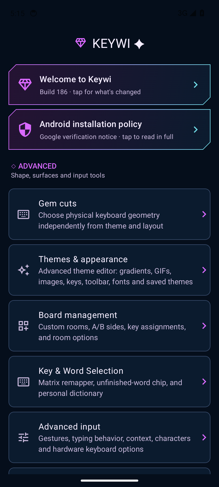

# Keywi settings guide ✦

**[Explore the illustrated SVG atlas](keywi-atlas.svg)** · Each chapter has a corresponding canonical guide page below. SVG links may be disabled in GitHub's image proxy, so the Markdown links remain the accessible navigation.

Welcome to your keyboard's control room. This guide follows the English settings in the build 516 source checkpoint (`c2f002d4`, 17 October 2026). Android's keyboard setup screens vary by device.

## Start here

1. Install [Keywi's latest APK](https://github.com/BirdMachine/Keywi/releases/latest).
2. Open Keywi and follow its setup flow to enable it and select it as your keyboard.
3. Open **Gem cuts** to choose the physical key arrangement.
4. Open **Themes & appearance** to choose or edit the look.
5. Scroll to the test field at the bottom of the main settings page and try typing.

Open the Keywi app whenever you need settings. HK-Like also has a **⚙** shortcut on its basic, symbol, and advanced layers.

## Find a setting

| Settings entry | What you can do | Guide |
| --- | --- | --- |
| Gem cuts | Choose ME-Like or experimental HK-Like; inspect the preview | [Cuts & layouts](cuts-and-layouts.md) |
| Themes & appearance | Manage themes; edit backgrounds, keys, toolbar, colors and fonts; tune size and feedback | [Themes & appearance](themes-and-appearance.md) |
| Board management | Create custom boards, assign tap/swipe/hold actions, edit A/B sides and board order | [Boards & key assignments](boards-and-keys.md) |
| Key & Word Selection | Remap character keys; show the unfinished-word chip; enable dictionary long-press | [Boards & key assignments](boards-and-keys.md) |
| Advanced input | Change gestures, field-aware behavior and physical-keyboard compatibility; read character-tool help | [Typing & clipboard](typing-and-clipboard.md) |
| Power options | Choose Unbridled, Conserved or Restricted | [Power, backup & diagnostics](power-backup-diagnostics.md) |
| Debug & diagnostics | Read, export or clear local diagnostic reports | [Power, backup & diagnostics](power-backup-diagnostics.md) |
| Character layouts | Choose the available character layouts | [Cuts & layouts](cuts-and-layouts.md) |
| Clipboard history | Enable history, cleanup, size limits and private clipboard | [Typing & clipboard](typing-and-clipboard.md) |
| Backup and restore | Export or replace the settings database; reset database settings | [Power, backup & diagnostics](power-backup-diagnostics.md) |
| Thumb-Key user guide (upstream) | Read the original project's guide | Useful background; Keywi-specific changes are covered here |
| About | Find build information, Keywi links and clearly marked upstream support links | [Troubleshooting](troubleshooting.md) |

## Three independent choices

| Choice | Changes | Example |
| --- | --- | --- |
| Gem cut | Physical key arrangement | ME-Like's 3×3 swipe core versus HK-Like's compact rows |
| Character layout | Characters and assignments in the saved layout | Choose a layout in Character layouts; customize its keys separately |
| Theme | Backgrounds, surfaces, borders, fonts and related appearance | A gradient with transparent key faces |

Changing a cut preserves the saved theme and character-layout settings. **HK-Like currently uses prototype character rows**, so it does not reproduce all saved ME character assignments. Custom boards and the matrix remapper should be approached as ME-layout tools in this checkpoint.

## Pictures and guide maintenance

Screenshots are captured from the actual app. [Screenshot notes](screenshots.md) records their version and capture details.

Maintainers: update these pages when labels or behavior change. See [the documentation capture workflow](maintaining-the-guide.md) for refreshing images without running an emulator on every APK build.
