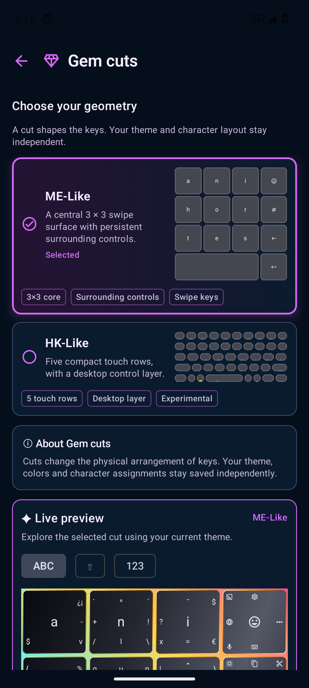

# Cuts & character layouts

[Guide home](README.md) · [Next: themes](themes-and-appearance.md)

## Choose a cut

Open **Settings → Gem cuts** and tap a choice. Selection saves immediately.

Actual emulator capture; the live preview continues below the visible area. [Capture provenance](screenshots.md).

| Cut | Arrangement | Current scope |
| --- | --- | --- |
| ME-Like | Central 3×3 swipe surface with surrounding controls | Preview follows the selected character layout and modified keys |
| HK-Like | Five compact touch rows with a desktop control layer | Experimental; uses its own prototype character rows and retains the saved ME layout |

The **Live preview** uses the selected cut and current keyboard theme. ME-Like's preview lets you inspect **ABC / ⇧ / 123** layers. Use a real text field to check typing and editor actions; preview interaction is not a substitute for that check.

HK-Like has basic, symbol and advanced layers. **?123** opens symbols and **⌘** accesses the advanced layer. The **⚙** key opens settings from each of these layers. HK keys use saved theme surfaces and borders; border width and radius also affect their rendering.

TD-Like is not included in this checkpoint.

## Choose characters

Open **Settings → Character layouts** and select the layouts you want available. The picker retains a fallback if you remove every selection. A layout chooses the character definitions; it does not choose a theme.

Use **Key & Word Selection** for individual character overrides and **Board management** for separate custom text/action boards. [Read the key assignment guide](boards-and-keys.md) before editing either.

## If the keys look wrong

For size and placement, go to **Themes & appearance → Keyboard tuning**. For key fill and border style, go to **Themes & appearance → Advanced theme editor → Keys**. A border style of **None**, a zero border width, or a transparent border color can make an outline disappear.

If the new cut is not visible in an already open editor, dismiss the keyboard and open it again, then check the selected cut in settings.
