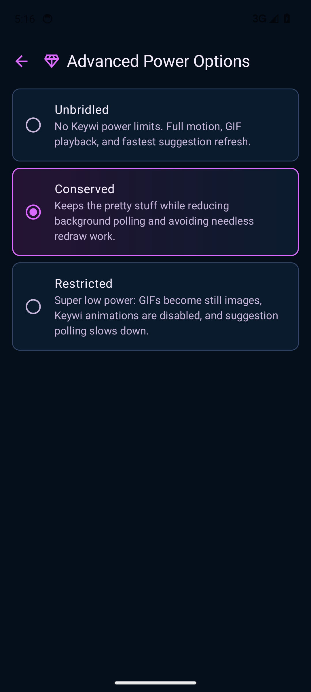
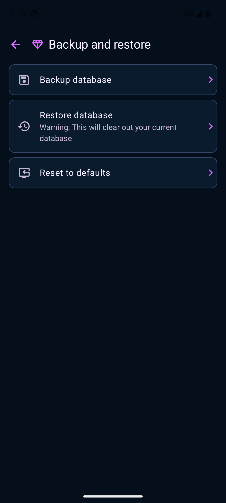

# Power, backup & diagnostics

[Guide home](README.md) · [Next: troubleshooting](troubleshooting.md)

## Power options

Open **Settings → Power options** and tap a mode; it saves immediately.

| Mode | Behavior |
| --- | --- |
| Unbridled | No Keywi power limits: full motion, GIF playback and fastest suggestion refresh |
| Conserved | Retains visual effects while reducing polling and avoidable redraw work |
| Restricted | GIFs become stills, Keywi animations are disabled and suggestion polling slows |

These are Keywi's own modes. Android's system battery settings can impose additional restrictions.

## What a backup includes

**Settings → Backup and restore → Backup database** exports the Room database through Android's file picker. **Restore database** replaces the current database; the screen explicitly warns that existing database content will be cleared.

This is **not a complete app backup**. It exports the app-settings database; clipboard contents live in a separate database and are not included. Gem-cut selection, custom boards, theme documents/assets and other preference-backed controls also live outside that export. Android's personal dictionary is separate too.

For a theme, also use **Themes & appearance → Export** to save a packaged theme with its media and fonts. Current board management has no board-export control; retain another record of important board assignments before clearing app data or moving devices.

**Reset to defaults** resets database-backed app settings after confirmation. It is not a universal erase of all Keywi themes, boards and preferences. To reset only the scratch theme, use **Reset Custom** in Theme manager.

## Read and share diagnostics

Open **Settings → Debug & diagnostics**. The screen shows version/build information, crash reports, Android process exits and recent Keywi events.

1. Reproduce the issue and note the app, cut, theme and action involved.
2. Tap **Refresh**.
3. Expand a crash report to read or select it. Its viewport scrolls vertically and horizontally.
4. Use **Export .txt** for one crash, or **Export / share all diagnostics** for the full report.
5. Add the report and reproduction steps to a [Keywi issue](https://github.com/BirdMachine/Keywi/issues).

Diagnostics are local and typed text is not intentionally recorded. Read an export before sharing it. **Clear** removes the local diagnostic history; export anything you need first.
