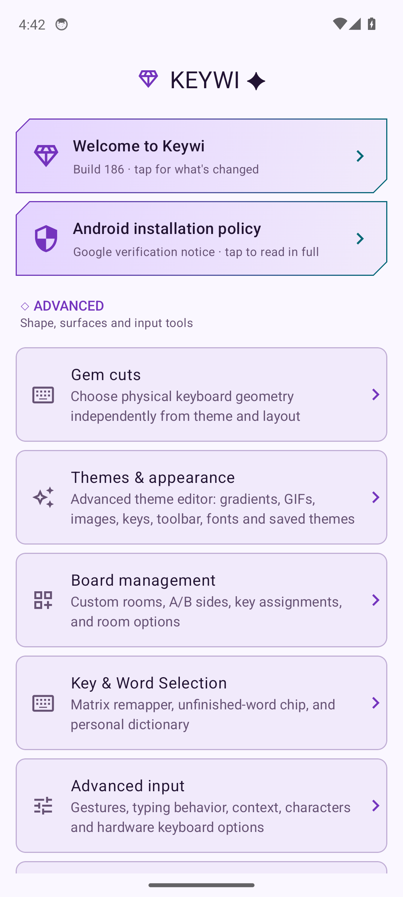

# Screenshot notes

[Guide home](README.md) · [Capture instructions](maintaining-the-guide.md)

## Settings overview

Captured from the actual Android app by [emulator run 39050341392](https://github.com/BirdMachine/Keywi/actions/runs/39050341392), commit `f27de50b`, on 17 October 2026. Pixel 6 profile, Android API 34, 1080×2400 at density 420. This is an unmodified settings-page capture; the banner's build 186 is the documentation/debug build value, not release build 516.

That run failed later in its live-keyboard capture sequence. This image documents only the settings overview shown above. No live-keyboard screenshots from that run are claimed as verified.

## Dark settings and Gem cuts

Captured by [successful settings run 39052686604](https://github.com/BirdMachine/Keywi/actions/runs/39052686604), source commit `4d77cfe1`, on 17 October 2026, using the same API 34 Pixel 6 profile and debug build label 186. All ten included page-label checks passed and all ten PNGs were visually reviewed. The screenshots show each page's initial state; longer screens continue below the visible area.

| Page | Screenshot |
| --- | --- |
| Settings overview | [View](images/settings-dark.png) |
| Gem cuts | [View](images/gem-cuts.png) |
| Keyboard tuning | [View](images/keyboard-tuning.png) |
| Board management | [View](images/boards.png) |
| Key & Word Selection | [View](images/key-remapper.png) |
| Advanced input | [View](images/advanced-input.png) |
| Context engine | [View](images/context-engine.png) |
| Power options | [View](images/power-options.png) |
| Clipboard history | [View](images/clipboard.png) |
| Backup and restore | [View](images/backup-restore.png) |

Theme manager and Advanced theme editor screenshots remain pending. Repeated emulator disconnects are tracked in [the capture instructions](maintaining-the-guide.md); their written instructions were checked against the app's source.
