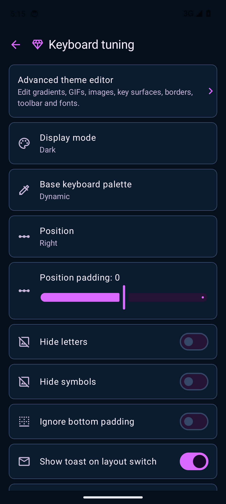

# Themes & appearance

[Guide home](README.md) · [Next: boards & keys](boards-and-keys.md)

Open **Settings → Themes & appearance**. This opens **Theme manager**, with the editor entry, saved-theme strip, test keyboard and **Keyboard tuning**.

## Edit, save and export a theme

1. Select a saved theme in the strip, or work in **Custom**.
2. Open **Advanced theme editor**, then choose a page from **Advanced themes**. Editing a saved theme copies it into Custom; the named original stays intact.
3. Adjust the appearance. Controls apply as you edit, so inspect the test keyboard as you go.
4. **Save** captures the current appearance into Custom. **Revert** restores the appearance captured when that editor session opened, including after visiting a subpage and returning; it is not a global history undo. Tap effects have their own immediate settings and are outside this appearance snapshot.
5. Return to Theme manager. With Custom active, choose **Save as…**, enter a **Theme name**, and save a named library entry.
6. Choose **Export** to write the active theme as a `.keywi-theme.zip` through Android's file picker. It includes the theme's app-owned image, GIF and font assets.

**Import** accepts a packaged theme or a supported JSON document and loads it into Custom. Inspect it, then use **Save as…** if you want a named entry. **Reset Custom** resets the scratch theme.

Saving a named theme and exporting a theme are separate actions in this version. Export does not automatically create a named library entry, request an author name, or open a share sheet. You can share the exported ZIP from your file manager. Android's file picker lets you choose a destination; open its location menu for Downloads, device storage and installed providers such as Drive. A provider must be installed, signed in and support the requested operation to appear. Keywi does not provide a separate Drive login.

An export is a file outside Keywi; **Save as…** creates an entry in Keywi's saved-theme strip. If a new file is absent from a file app's Recent view, browse the destination selected during export and search for `.keywi-theme.zip`. Import loads into Custom; save it under a name to add a library tile.

Schema 3 packages include visual appearance, referenced background media and imported fonts. They do not contain the separate key flash/fade preferences, action effects, sound customization or board geometry. See the [round-trip and media capture checklist](theme-roundtrip-and-capture.md) for verification and recording.

## Advanced theme editor

Advanced themes is a hub of dedicated subpages. Enable **custom keyboard backgrounds** to edit backgrounds, suggestion styling, keys and typography. Turning it off uses the original Thumb-Key styling. **Tap effects** remains available independently.

| Subpage | Controls and effect |
| --- | --- |
| Keyboard background | Main backdrop mode, opacity, media selection and gradients |
| Suggestion bar | Toolbar backdrop, toolbar border and gap above keys; lozenge fills and borders; current-word background and highlight |
| Keys | Transparent, solid or gradient faces; none, solid, gradient or shadow border styles |
| Typography | Import a font or return to System default; choose suggestion motion style |
| Tap effects | Tap/fade color frames and timing, drag trails, GIF/PNG artwork, placement and playback |

Open a subpage to edit its controls. Detailed gradient and color controls can still expand within a page. **Choose media / Change media** copies selected background assets into Keywi-managed storage. If Theme manager reports missing original assets from an older theme, reselect them in the editor and export again.

The toolbar backdrop, suggestion lozenges, current-word chip and key borders are separate settings. The suggestion toggle uses the key border styling; changing a lozenge outline alone will not change that border.

For the main backdrop and toolbar backdrop, choose a mode:

| Mode | What appears |
| --- | --- |
| Colorful | A gradient; opens the gradient controls |
| Image | The selected still image |
| Gif | The selected animation, subject to power mode |
| None | No custom backdrop on that surface |

Backdrop opacity changes that surface independently. Transparent key faces and transparent lozenge faces have their own **None** settings; neither removes the main backdrop.

## Colors and gradients

Open **Edit color** to expose the color picker. The large field controls saturation horizontally and brightness vertically. The hue strip chooses the color family. **Opacity** controls alpha; **RGB channels** exposes individual channel sliders.

For backdrop gradients, first select **Colorful**; for key or lozenge gradients, select **Gradient**. Choose a **GRADIENT PRESET** or **＋ New gradient**, then expand **Edit gradient**. Adjust the angle and expand the color-stop list to change each stop's position and color. Add stops with **＋ Add stop**; delete is available while more than two stops remain. **Save as** in this section saves a gradient preset, not a complete keyboard theme.

## Keyboard tuning

From Theme manager, open **Keyboard tuning** for display mode, base palette, position, padding, key sizing, border width, radius, label visibility, animation speeds, vibration and tap sound. Some size controls become available only after changing automatic sizing or non-square-key options.

Use the theme editor for the border's style and color; use tuning for its width and key corner radius. For example, choose a solid border in the editor and a visible width in tuning before judging its contrast in a text field.

## Media and motion

Restricted power mode turns GIFs into still images and disables Keywi animations. Check [Power options](power-backup-diagnostics.md) before troubleshooting a frozen animated theme.

Open **Advanced themes → Tap effects** for **Key flash & drag trails** and **Action artwork** on one page. Add, recolor, reorder or remove fade frames; set **Fade-out** and **Drag trails**; use **Preview fade** to inspect the sequence. **Add GIFs / PNGs** copies action artwork into Keywi. Overlay controls include gesture/key assignments, origin, layer, press/release timing, duration, cooldown, overlap, opacity and size. Use the test keyboard on the same page for actual typing.

The main **Keypress effects** shortcut links to this same Tap effects page and to **Sounds & sound packs**. The legacy overlay route also opens Tap effects. These settings apply immediately, and remain separate from schema 3 appearance exports. This subpage organization is documented for the pending Dev change; release build 685 has the earlier combined editor.
