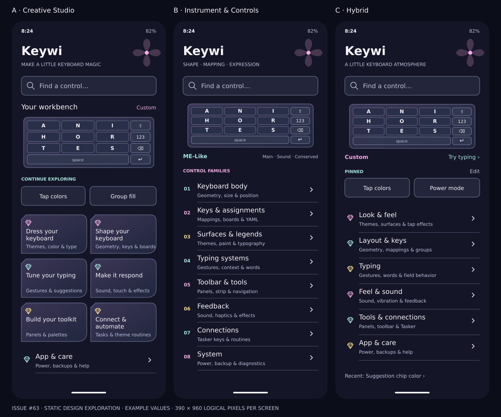
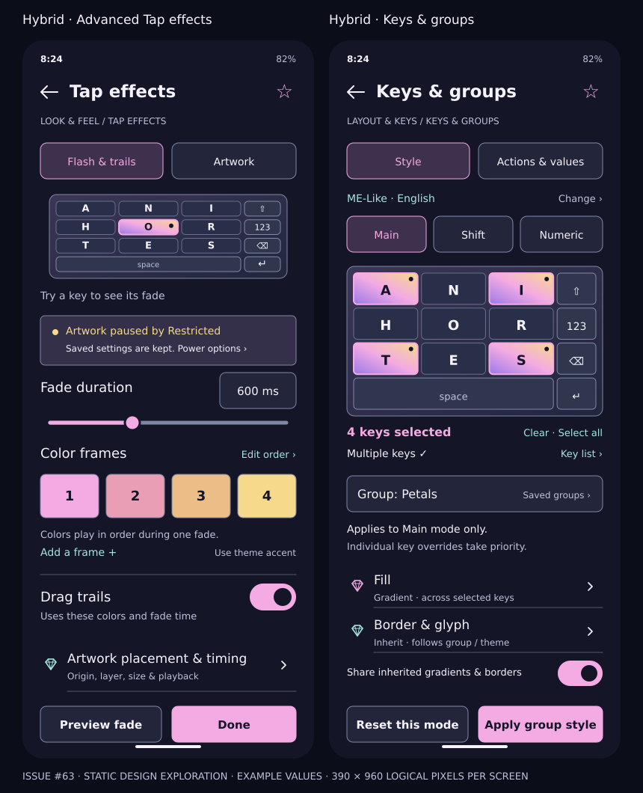

# Keywi settings: a creative instrument

**Exploration for [issue #63](https://github.com/BirdMachine/Keywi/issues/63). Proposal only; no redesigned Android UI is implemented.**

Reviewed 2026-11-14 against `Dev` at [`8ef014017a020346da3d3e2f8922bb184a51688b`](https://github.com/BirdMachine/Keywi/tree/8ef014017a020346da3d3e2f8922bb184a51688b). Integration branch: `Dev`; release branch: `main`. A concurrent Dev-to-main promotion does not change this recorded baseline.

> Keywi should feel like a creative instrument. Keep the knobs; make the next useful knob easy to find.

## Read this exploration

1. [Current navigation, source evidence and UX findings](current-map.md)
2. [Complete current control inventory](inventory.md) — 275 catalog entries, including commands and parameterized editors; not 275 independent preferences
3. [Three alternative architectures](alternatives.md) — complete destination trees, tradeoffs, and mapped controls
4. [User journeys and evaluation](journeys.md)
5. [Visual direction and mobile wireframes](visual-design.md)
6. [Recommendation, compatibility and migration plan](migration.md)
7. [Verification and review checklist](verification.md)

[Download / inspect the control-by-control mapping](inventory.csv). Every inventory entry has a destination in Creative Studio, Instrument & Controls, and Hybrid.

## Recommendation

Choose **Hybrid**: six stable front doors — **Look & feel**, **Layout & keys**, **Typing**, **Feel & sound**, **Tools & connections**, and **App & care**. Keep expressive language in descriptions and examples, with literal, searchable control labels. Put a small live preview, search, and optional pinned/recent controls above those destinations.

The key structural change is a **shared Keys & groups editor** opened with a target and task (Style or Actions), rather than treating its mixed current contents as one category. Put dictionary behavior under Typing, toolbar management under Tools, and sizing under Layout. Keep geometry, mappings, board assignments, and appearance as separate data domains.

This is a source-based UX review and a set of design hypotheses. Wireframes are authored SVG documentation, rendered to PNG; they are not device screenshots, clickable app code, or measured evidence of usability. Their example themes, groups, recent controls and numeric values are illustrative.

## Parallel work and pending proposals

Issue [#62](https://github.com/BirdMachine/Keywi/issues/62), now proposed in [PR #64](https://github.com/BirdMachine/Keywi/pull/64), independently handles gesture-label fitting and collapsible key-editor sections. This exploration does not change its renderer, hitboxes, text sizing, preferences, or section implementation. PR #64 keeps Gesture Actions and Character Values independently collapsible and preserves their composed drafts/selection. Those two sections can later be hosted inside the Actions & values task without discarding that work. Its PR describes no new sizing preference; any optional sizing control remains future work.

Open PRs inspected as context, not assumed to be merged:

- [#60](https://github.com/BirdMachine/Keywi/pull/60): Advanced themes hub/subpages and combined Tap effects. Adopt its page ownership concept if merged; do not recreate or overwrite its implementation here.
- [#56](https://github.com/BirdMachine/Keywi/pull/56): theme-library management and schema 4 flash portability. Baseline remains schema 3; these are separate compatibility decisions.
- [#58](https://github.com/BirdMachine/Keywi/pull/58): offline Unicode library. Reserve a future Tools destination if it lands; do not present it as present on this baseline.
- [#57](https://github.com/BirdMachine/Keywi/pull/57): experimental chromatic UI lab. Material recipes and jump rails are optional visual research, not current canonical settings.
- [#61](https://github.com/BirdMachine/Keywi/pull/61): theme export/documentation and round-trip evidence. Reconcile guide copy after its merge rather than asserting that pending docs already describe Dev.

Do not close #63 or merge this recommendation as a UI decision automatically. Review the alternatives, then choose scope for a separate implementation PR.
