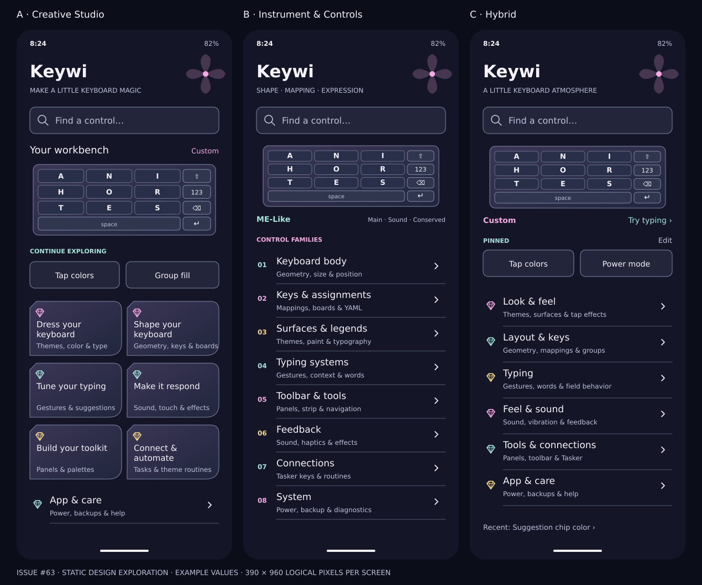
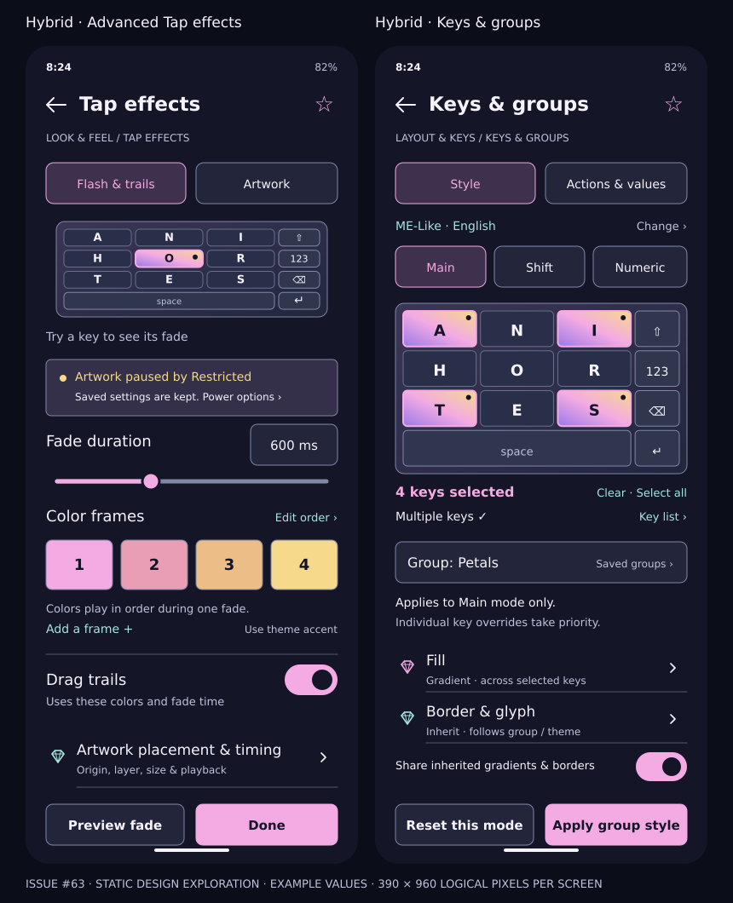

# Visual design: chromatic workbench

## Wireframes

These are exact-text SVG wireframes rendered to PNG, with illustrative data. The scenes explore information hierarchy and visual character; they do not implement Keywi settings. A production preview must use the real active keyboard definition and accessible alternatives. The schematic key diagrams show a simplified ME-like body/rail, not exact live legends, gesture hitboxes or an assertion that all cuts use the same topology.

| View | Editable vector | PNG |
| --- | --- | --- |
| Creative Studio Home | [SVG](visuals/home-studio.svg) | [PNG](visuals/home-studio.png) |
| Instrument & Controls Home | [SVG](visuals/home-instrument.svg) | [PNG](visuals/home-instrument.png) |
| Hybrid Home, dark | [SVG](visuals/home-hybrid.svg) | [PNG](visuals/home-hybrid.png) |
| Hybrid Home, light | [SVG](visuals/home-hybrid-light.svg) | [PNG](visuals/home-hybrid-light.png) |
| Hybrid advanced Tap effects | [SVG](visuals/advanced-tap-effects.svg) | [PNG](visuals/advanced-tap-effects.png) |
| Hybrid Keys & groups | [SVG](visuals/keys-groups.svg) | [PNG](visuals/keys-groups.png) |
| Three-home comparison | [SVG](visuals/home-comparison.svg) | [PNG](visuals/home-comparison.png) |
| Two-editor comparison | [SVG](visuals/editor-comparison.svg) | [PNG](visuals/editor-comparison.png) |





## What changes between proposals

**Creative Studio** uses a workbench preview and six paired petal-edged destinations, then App & care. It is the most inviting, but relies on shorter descriptions and a two-column layout. At narrow widths or enlarged type it must become a single flowing list, not shrink labels.

**Instrument & Controls** uses numbered, ruled subsystem rows. Compact current-state summaries identify geometry, active mode, feedback and power. It has the strongest literal component organization and the greatest risk of feeling technical. Numbers are visual ordering aids, not mnemonics users must memorize.

**Hybrid** uses six open rows separated by quiet rules, a single keyboard preview and a small optional pin rail. Repeated solid cards do not fill the page. Gem outlines identify families; the four-petal accent is decorative. Current theme/preview and category labels provide the structure even without decoration.

## Detailed views and interaction intent

**Advanced Tap effects** uses a Flash & trails / Artwork task switch, one test preview, a policy-status strip, fade duration with a precise-value affordance, ordered color frames, drag trails and a clear artwork detail link. Source duration supports 0–5000ms; the wireframe’s 600ms is only an example. No new flash model is proposed. Color-frame reordering remains a deliberate edit action, not a swipe-only interaction. The artwork suppression message shows the distinction between saved enablement and effective power policy. The “Power options” text is a real shortcut candidate, not an automatic mode change.

“Done” closes the live-controls page; it does not claim to commit a multi-store transaction. “Preview fade” uses the existing local-preview concept. Any later Undo action would need domain support and is not shown as a working baseline feature.

**Keys & groups** keeps the visual target at the top and the selected task below a persistent context header. Main/Shift/Numeric are explicit. A selection count, per-cell selection marker and text equivalent reinforce color highlighting. The group name, mode scope and precedence explanation remain adjacent to style controls. Fill opens the shared Gradient editor; Border & glyph opens inheritance-aware controls. The action at the bottom says **Apply group style**, and **Reset this mode** states reset scope. Single-key style must instead explain its across-mode scope.

The illustration does not try to fit every existing control into one viewport. Saved groups, a full key-list selection alternative, group creation/name validation, multi-selection, target identity, all actions/effects/Tasker/text values and expert YAML remain reachable as specified in the inventory and trees. If many controls exist, pages scroll with selection/context retained. The shared canvas toggle remains separate from assigned fill behavior: assigned fill gradients fit the selected keys even when inherited canvas sharing is off.

The #62 / PR #64 Gesture Actions and Character Values sections can both fit inside the Actions & values task surface. This document does not dictate their implementation, default collapse state or gesture-label sizing. A future optional label-size setting, if accepted there, belongs with legends/targeted key appearance; long kaomoji labels still cannot change hitboxes or corrupt graphemes.

## Glass, gem, petal, chromatic

- **Glass:** shallow translucent edges or reflective gradients around a preview/work surface; opaque control/text surfaces keep contrast stable. Artwork never becomes an uncontrolled background behind labels. Settings following the keyboard is optional; readability takes priority over a theme’s darkest/lightest pixels.
- **Gem:** cut corners for focus or selection; small faceted family glyphs; no massive decorative diamonds consuming the first viewport.
- **Petal:** four-part mark and occasional asymmetric container edge; soft overlapping shape at a section transition. No unlabeled flower menu, dragging petals or spatial memorization required.
- **Chromatic:** color belongs to editable swatches, the selected preview and a thin accent. Hue is supplemental to a label/state. Never place rainbow gradients under body copy or rely on rainbow color to distinguish actions.

## Tokens to prototype

| Role | Dark | Light | Intended use |
| --- | --- | --- | --- |
| Page | `#141627` | `#F7F3FA` | Calm ground |
| Text-control surface | `#23263B` | `#E7E6F1` | Stable, mostly opaque |
| Main text | `#F6F3FC` | `#202037` | Headings and labels |
| Supporting text | `#BEC2DB` | `#535A76` | Descriptions, current values |
| Control outline | `#8088A8` | `#727995` | Interactive boundary |
| Rose accent | `#F4AAE3` | `#7C286F` | Selection and creative emphasis |
| Sea-glass accent | `#A6E5DE` | `#146C69` | Shortcut and secondary emphasis |
| Warm accent | `#F6D98B` | `#735820` | Policy/status, not color-only warnings |

Keep the existing gem-language direction (navy/violet and magenta selection) while reducing enclosure density. Recipes such as opal or cobalt from #57 can later decorate preview material, without controlling navigation semantics.

## Accessibility and adaptation contract

The mobile artboards are **390×960 logical pixels**, an expanded review viewport, not proof that every production phone can show the entire page without scrolling. Settings rows/buttons aim for at least 48dp tap regions; a production switch’s hit region extends beyond its visible 34–36px track. Inline text links, stars, color swatches, numeric duration fields and grip actions need explicit accessible targets too. Decorative gem/petal shapes are excluded from accessibility focus.

Use approximately 16sp control labels, 14sp supporting copy and 22–28sp page titles in the production study. The paired Studio tiles are a density hypothesis; switch them to single-column at 320dp or enlarged type. Preview labels may be smaller as a diagram only, with a visible **Key list** providing full text and target selection. Never shrink settings text to make a screenshot fit.

Requirements for future implementation:

- Verify ordinary text contrast ≥4.5:1 and interactive boundary/focus contrast ≥3:1 against actual composed backgrounds. Palette-pair checks are necessary, not sufficient for blur/media.
- At 150%/200% text, descriptions wrap, row heights grow, chips flow/wrap, and bottom actions reflow or stack. Context and action rows never cover focused controls when the IME opens. Landscape/windowed layouts use available space without assuming portrait height.
- TalkBack names each control, announces selection/count/mode/inheritance and disabled reasons; focus follows the deep-linked target. Key diagram selection has a list/grid alternative with row/column and real action labels. Numeric inputs are an alternative to dragging every slider, stop and spectrum.
- Do not hide essential actions behind hold, swipe, drag or hover. Selection, reorder, reset and navigation all have visible buttons/menus. Back/Up remains predictable from direct launches.
- For reduced motion, keep changes immediate or use a short fade; no compulsory carousel, parallax, spinning gems or sweeping focus animation. For reduced transparency/Restricted/Desperate modes, use flat surfaces and clear text without destroying the saved theme.
- Editor control chrome remains readable even when the keyboard theme uses transparent faces, bright artwork or missing fonts. Settings text uses a reliable UI font; imported keyboard fonts stay in previews unless explicitly chosen for the app.
- Precise label fitting is owned by #62; wireframe preview text is not evidence that its implementation passes long-label, Unicode or physical-device checks.

## Regenerate the documentation art

Run `python docs/settings-architecture/visuals/generate_wireframes.py` from the repository root. It writes standalone SVGs with no linked fonts/images/scripts. Render with Node plus the `sharp` package available in the authoring environment:

```js
const sharp = require('sharp');
const fs = require('fs');
const directory = 'docs/settings-architecture/visuals';
(async () => {
  for (const name of fs.readdirSync(directory).filter(name => name.endsWith('.svg'))) {
    await sharp(`${directory}/${name}`).png().toFile(`${directory}/${name.replace('.svg', '.png')}`);
  }
})();
```

The generator is documentation tooling only and has no connection to Android UI or preference writes. PNGs were visually inspected at generation; app accessibility and behavior remain unverified.
